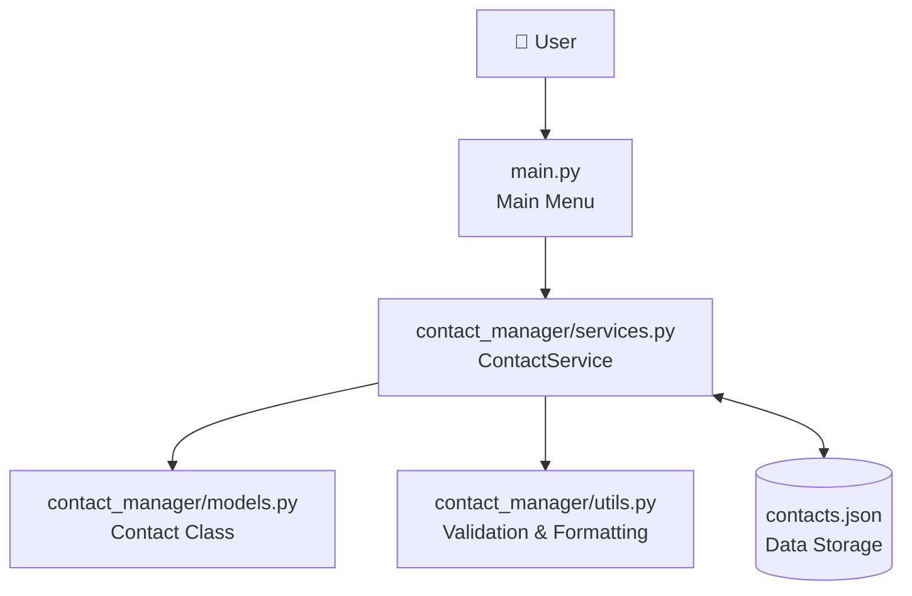

# 📇 Contact Management System

<p align="center">
  <b>A Python-based Contact Management System using OOP, Custom Modules, and JSON File Storage.</b>
  <br>
  A simple and beginner-friendly project to manage contacts efficiently.
</p>

---

## 📌 Project Overview

The **Contact Management System** is a Python application that allows users to store, manage, search, update, and delete contact information.

This project is developed using **Object-Oriented Programming (OOP)** and a modular architecture. It uses JSON files to save contact information permanently, so the data remains available even after restarting the application.

### ✨ Key Features

- ➕ **Add Contact:** Add a new contact with name, email, phone, and address.
- 📋 **View Contacts:** Display all saved contacts.
- 🔍 **Search Contact:** Find contacts using full names, partial names, or phone numbers.
- ✏️ **Update Contact:** Modify existing contact information.
- 🗑️ **Delete Contact:** Remove unwanted contacts.
- 🛡️ **Input Validation:** Validate email addresses and 10-digit phone numbers.
- 💾 **JSON Storage:** Automatically save and load contact information.
- 📦 **Modular Architecture:** Organize code into separate Python modules.

---

## 🛠️ Technologies Used

| Technology | Purpose |
|---|---|
| Python | Main programming language |
| OOP | Organizing code using classes and objects |
| JSON | Permanent data storage |
| VS Code | Code editor |
| Git & GitHub | Version control and project hosting |

---

## 📊 System Architecture

The application follows a modular structure where each file has a specific responsibility.



### How It Works

1. The user interacts with the application through `main.py`.
2. The main file calls methods from `contact_manager.services`.
3. The Contact class in `contact_manager/models.py` validates and manages contact information.
4. The utility functions in `contact_manager/utils.py` validate and format user input.
5. The `contacts.json` file stores contact information permanently.

---

## 📁 Project Folder Structure

```text
Contact-Management-System/
│
├── contact_manager/
│   ├── __init__.py        # Package initialization file
│   ├── models.py          # Contact class and validation logic
│   ├── services.py        # Add, search, update, delete operations & JSON storage
│   └── utils.py           # Email validation and phone formatting functions
│
├── main.py                # Main program entry point and menu
├── contacts.json          # Permanent contact storage file
├── .gitignore             # Git ignore file
└── README.md              # Project documentation
```

### 📋 File Responsibilities

| File | Responsibility |
|---|---|
| `contact_manager/__init__.py` | Marks directory as a Python package for clean imports. |
| `contact_manager/models.py` | Defines the Contact class with email & phone validation. |
| `contact_manager/services.py` | Handles contact management operations and robust JSON storage. |
| `contact_manager/utils.py` | Contains reusable validation and formatting functions. |
| `main.py` | Provides the interactive command-line interface. |
| `contacts.json` | Stores contact information permanently. |
| `.gitignore` | Prevents virtual environments, cache, and sensitive files from being tracked. |

---

## 🖥️ Application Menu

The application provides a simple command-line interface.

```text
====================================
       CONTACT MANAGEMENT SYSTEM
====================================

1. Add Contact
2. View All Contacts
3. Search Contact
4. Update Contact
5. Delete Contact
6. Exit

====================================
Enter your choice (1-6):
```

### Example: Adding a Contact

```text
--- Add New Contact ---

Enter Name: Rahul Sharma
Enter Email: rahul@example.com
Enter Phone: 9876543210
Enter Address: Delhi, India

Contact 'Rahul Sharma' added
and saved successfully!
```

### Example: Viewing Contacts

```text
--- All Contacts (Total: 1) ---

Contact #1

Name    : Rahul Sharma
Email   : rahul@example.com
Phone   : 987-654-3210
Address : Delhi, India
```

### Example: Updating a Contact

```text
--- Update Contact ---

Enter Name: Rahul

New Phone: 9998887776

Contact updated and saved successfully!
```

---

## 💾 JSON Data Storage

The application uses a `contacts.json` file to store contact information.

Example:

```json
[
    {
        "name": "Rahul Sharma",
        "email": "rahul@example.com",
        "phone": "999-888-7776",
        "address": "Delhi, India"
    }
]
```

**Benefits of JSON Storage:**

- No database required.
- Easy to read and understand.
- Data remains saved after closing the application.
- Simple to load and update using Python's built-in `json` module.

---

## 🧠 Python Concepts Used

This project demonstrates important Python programming concepts.

| Concept | Implementation |
|---|---|
| Class | `Contact` and `ContactService` |
| Object | Creating contact objects |
| Constructor | `__init__()` |
| self keyword | Accessing object attributes |
| Methods | Add, delete, search and update |
| Encapsulation | Managing contact data and operations inside classes |
| Modules | Separating code into different `.py` files |
| Packages | Organizing modules inside a package |
| Import | Reusing classes and functions from other files |
| File Handling | Reading and writing JSON files |
| Exception Handling | Handling invalid input and file errors |

---

## 🚀 Installation & Setup

### Requirements

- Python 3 installed on your computer.
- VS Code or any Python-supported editor.
- No external Python libraries required.

### Step 1: Clone the Repository

```bash
git clone https://github.com/85kartik/Contact-Management-System.git
```

### Step 2: Open the Project Folder

```bash
cd Contact-Management-System
```

### Step 3: Run the Application

```bash
python main.py
```

**For Windows users:** You can also use:

```bash
py main.py
```

### Step 4: Start Managing Contacts

Choose an option from the menu and follow the instructions displayed in the terminal.

---

## 🎓 College Viva Preparation

Some important questions and answers related to this project.

**1. What is the purpose of this project?**

To create a system that manages contact information using Python OOP and custom modules.

**2. What is OOP?**

OOP stands for Object-Oriented Programming. It is a programming approach based on classes and objects.

**3. Why did you create multiple Python files?**

To organize the code properly and make it easier to understand, reuse, and maintain.

**4. What is JSON?**

JSON stands for JavaScript Object Notation. It is a lightweight format used to store and exchange data.

**5. Why did you use JSON instead of a database?**

Because this is a small beginner-level project, JSON provides a simple way to store data permanently without requiring a database.

**6. What is the purpose of `__init__()`?**

It is a constructor that initializes object attributes when an object is created.

**7. What is the purpose of `self`?**

It refers to the current object of a class.

**8. What is the purpose of `utils.py`?**

It contains reusable helper functions such as email validation and phone number formatting.

**9. What is the purpose of `services.py`?**

It handles the main contact operations, such as adding, searching, updating, and deleting contacts.

**10. What is the purpose of `to_dict()`?**

It converts a Contact object into a dictionary so its data can be stored in JSON format.

---

## 🔮 Future Improvements

The project can be extended with additional features:

- 🔐 Password-protected login system.
- 🗄️ MongoDB or SQLite database integration.
- 📱 Graphical User Interface (GUI).
- 📤 Export contacts to CSV.
- 📥 Import contacts from CSV.
- ⭐ Mark contacts as favorites.

---

## 👨‍💻 Project Information

**Project Name:** Contact Management System

**Language:** Python

**Architecture:** Object-Oriented and Modular

**Storage:** JSON File

**Project Type:** College Assignment / Beginner Python Project

---

<p align="center">
  <b>Made with ❤️ using Python</b>
  <br>
  <i>Learning Python through practical projects.</i>
</p>